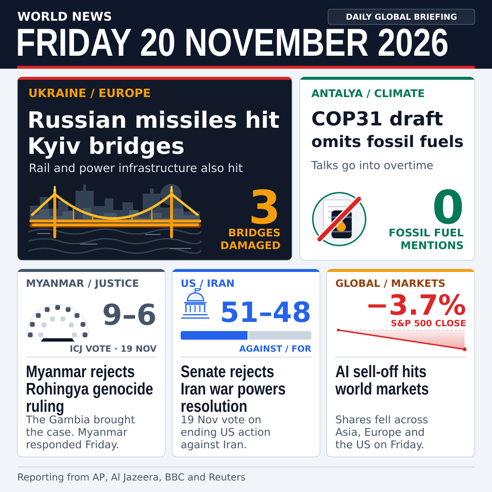

# Friday 20 November 2026 · World news

[](https://make.fun/bounty/news-image-20261120?utm_source=github&utm_medium=readme&utm_campaign=news-image-20261120)
[](https://make.fun/bounty/news-image-20261120/leaderboard?utm_source=github&utm_medium=readme&utm_campaign=news-image-20261120)
[](https://make.fun/bounty/news-image-20261120?utm_source=github&utm_medium=readme&utm_campaign=news-image-20261120)

Five illustrated panels summarize the attacks on Kyiv crossings, the COP31 draft, the Rohingya ruling and Myanmar's response, the Iran war powers vote, and the global sell-off in AI shares.



## Run it

```sh
node main.ts
```

Node 22 validates the PNG header, dimensions, and size, then writes its exact bytes to `/output/entry.png` with mode `0644`. The output directory must be writable. The entry uses built-in modules only, with no network, clock, or randomness.

## Rebuild and verify the artwork

The editable source is [assets/entry.svg](assets/entry.svg), authored directly by [tools/render_entry.py](tools/render_entry.py). Its five-panel layout preserves the approved story wording and numbers. It uses a navy masthead, white bordered supporting cards, distinct category accents, and a dark slate Kyiv lead with gold highlights.

```sh
python3 tools/render_entry.py
python3 tools/verify_entry.py --node node
```

Building uses Python's standard library, the system librsvg/Cairo/Pango libraries, and the DejaVu Sans and Liberation Sans Narrow fonts. All rendering is offline. The renderer measures actual font ink to reject text overflow or overlap and saves local 512px and 300px review images under the ignored `.private/phase7/` directory. The verifier checks PNG chunk checksums and decoded scanlines, then runs `main.ts` twice with Node 22 through the actual `/output/entry.png` path and compares SHA-256 hashes.

The illustrations are original SVG shapes. The bridge and skyline are symbolic. The chamber contains exactly nine dark seats and six light seats; the Senate bar lengths are proportional to 51 against and 48 for. The red market area connects only the previous close and the verified Friday close, down 3.7%; it does not invent an intraday price series. The fossil-fuel slash refers to omitted mentions in the **draft**, as labeled.

## Reporting

- Russian strikes damaged three Kyiv bridges. [BBC](https://www.bbc.com/news/articles/c6x29gn4pdn9o) · [Al Jazeera](https://www.aljazeera.com/news/2026/11/20/russia-unleashes-retaliatory-barrage-on-kyiv-bridges)
- The COP31 draft dropped fossil fuel mentions and talks ran beyond Friday. [BBC](https://www.bbc.com/news/articles/c6ly5w40eg07o) · [Al Jazeera](https://www.aljazeera.com/news/2026/11/20/fossil-fuel-talks-deadlock-pushes-cop31-climate-summit-into-overtime)
- Myanmar rejected the International Court of Justice judgment on Friday, after a 9–6 ruling on Thursday. [AP via Sentinel Colorado](https://sentinelcolorado.com/nation-world/myanmar-dismisses-the-un-courts-ruling-on-its-responsibility-for-rohingya-genocide-as-unfair/) · [Al Jazeera](https://www.aljazeera.com/news/2026/11/20/myanmar-china-object-to-unfair-icj-genocide-ruling)
- The U.S. Senate rejected the Iran war powers resolution with 51 votes against and 48 for on 19 November. [AP via PBS](https://www.pbs.org/newshour/politics/watch-live-senate-meets-for-legislative-business-as-trump-returns-from-putin-xi-talks-in-china) · [Al Jazeera](https://www.aljazeera.com/news/2026/11/19/senate-republicans-in-us-reject-measure-to-limit-trumps-war-powers-in-iran) · [Senate roll call](https://www.senate.gov/legislative/LIS/roll_call_votes/vote1192/vote_119_2_00269.htm)
- The S&P 500 closed down 3.7% on Friday. [BBC](https://www.bbc.com/news/articles/c6808ym10vzgo) · [Reuters via The Straits Times](https://www.straitstimes.com/business/companies-markets/wall-st-ends-sharply-lower-on-ai-selloff-sp-500-dow-in-correction)

MIT licensed.

---

<sub>Built for the [make.fun bounty](https://make.fun/bounty/news-image-20261120). [Referral link](https://make.fun/?ref=87cdjapv&utm_source=github&utm_medium=readme&utm_campaign=news-image-20261120)</sub>
